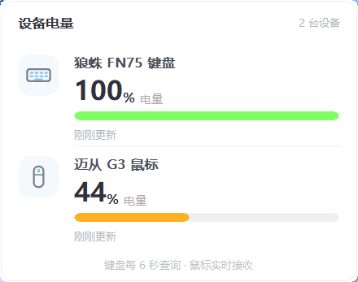

# c-tray — 2.4G 设备电量托盘（C 版）

[Python 版](https://github.com/ahutsunboy/2.4g-battery-tray-python) 的功能等价重写，目标是**极轻**：单个 exe、零运行时依赖、私有内存 2.5 MB 量级。



```
c-tray/
├─ build.bat            构建脚本（MinGW-w64）
├─ capture.bat          一键抓帧实验（排查断连信号用）
├─ src/
│   ├─ hid.h/.c         HID 枚举 + 带超时的异步读写（HidIo 常驻事件）
│   ├─ devmon.h/.c      设备监控线程 + 断连状态机（核心）
│   ├─ art.h/.c         图标栅格化：托盘电池图标 + 设备图标（4× 超采样）
│   ├─ tray.c           托盘主程序：卡片、菜单、通知
│   ├─ settings.h/.c    UTF-8 INI 配置读写
│   ├─ log.h/.c         文件日志（256 KB 轮转）
│   ├─ dump.c           原始帧记录器（开发工具）
│   ├─ capture.c        分阶段关机实验（开发工具）
│   └─ dmtest.c         监控层控制台测试台（开发工具）
└─ probe/               内存测量 + 截图 + 窗口探查
```

## 从 GitHub 拉下来怎么跑

### 1. 取代码

```bat
git clone https://github.com/ahutsunboy/2.4g-battery-tray-c.git
cd 2.4g-battery-tray-c
```

没装 git 就在仓库页点 **Code → Download ZIP**，解压后进目录。

### 2. 装编译器：只需要 MinGW-w64

仓库里不存 exe（都由 `build.bat` 现场编译），所以第一次需要一个 C 编译器。
**不需要 Visual Studio**，一个 64 MB 的 w64devkit 就够：

1. 打开 <https://github.com/skeeto/w64devkit/releases>
2. 下载 `w64devkit-x64-*.7z.exe`（自解压包）
3. 解压到任意目录，推荐 `D:\tools\env\mingw64`

`build.bat` 会自动找 gcc，**不用改脚本**，按这个顺序找：

| 顺序 | 位置 |
|---|---|
| 1 | 环境变量 `GCC` |
| 2 | `PATH` 里的 `gcc` |
| 3 | 仓库旁边的 `..\mingw64\bin\gcc.exe` |
| 4 | `D:\tools\env\mingw64\bin\gcc.exe` |
| 5 | `C:\msys64\mingw64\bin\gcc.exe` |
| 6 | `C:\w64devkit\bin\gcc.exe` |
| 7 | `%LOCALAPPDATA%\Programs\mingw64\bin\gcc.exe` |

已经装了 MSYS2 的，直接 `set GCC=C:\msys64\mingw64\bin\gcc.exe` 即可。
验证：`gcc --version` 能打印出版本号。

### 3. 编译

```bat
build.bat tray
```

第一行会打印 `using gcc: <实际找到的路径>`，七个目标依次编译，最后输出 `done.`
主程序就是目录下的 **`tray.exe`，约 81 KB**。

```bat
build.bat          :: 只编开发工具（dump / capture / dmtest / feat2 / featprobe / iconout）
build.bat tray     :: 再加主程序 tray.exe
build.bat lowtest  :: 再加 tray_lowtest.exe（诊断用，可注入假电量，不要拿去分发）
```

体积就是这么来的：`-O2` 优化、`-mwindows` 不要控制台窗口、
`-static` 把 libgcc / winpthread 静态链进去、`-s` 去掉符号表。

### 4. 运行

双击 `tray.exe`，没有安装步骤。

- 托盘区出现电池图标（Win11 默认收进 `^` 溢出区，拖到任务栏可以常显）
- 左键点图标 → 展开卡片；点别处、按 Esc、再点一次图标 都会收起
- 右键 → 开机自动启动 / 低电量提醒 / 查看日志 / 退出
- 第一次运行会在 exe 旁边生成 `settings.ini` 和 `tray.log`

**整个文件夹可以随便搬**：U 盘、D 盘、别的电脑都行。程序启动时会把开机自启
路径校正到自己当前所在的位置，搬完运行一次就重新绑定，不会因为换目录导致自启失效。

系统要求：Windows。实测 Win10 / Win11；用到的都是老 API，DPI 感知那条是运行时
动态取 `SetProcessDpiAwarenessContext`，取不到会自动降级到系统默认。

### 5. 只想用、不想编译

仓库暂时不放预编译包 —— 一共 81 KB，编译一次几秒钟，按上面第 2、3 步走一遍就有了。

## 实测占用对比

| 指标 | Python 版 | C 版 | 倍数 |
|---|---|---|---|
| 主程序体积 | PyInstaller 打包 10 MB 级 | **77 KB** | ~130× |
| 私有提交 | ~19 MB | **2.57 MB** | ~7.4× |
| 工作集（活跃） | 30.3 MB | **6–12 MB** | ~3–5× |
| 工作集（空闲归还后） | 2.5 MB | **0.6 MB** | ~4× |
| 线程 | 多 | 5（主线程 + 监控 + HID 读线程 + 系统池） | — |

工作集区间来自「是否刚和外壳交互过」：托盘气泡、提示文本更新会让
explorer 侧映射的页面短暂留在工作集里，空闲 120 秒后一次性还回去。

## 界面：和 Python 版是同一张图

卡片与托盘图标不是「照着做的」，是**同一套几何和配色重算一遍**：

- 版式常量逐个对齐 Python 的 `BatteryTray` 类：`WIDTH=352 PAD=18 HEADER=44 ROW=100 FOOTER=34`
- 配色直接抄 `tray_app.py` 顶部那组常量（白底 / `#30313A` 大字 / `#7FFF62` 胶囊条）
- 字号用**像素高**而不是磅（`13 / 13 / 26 / 13 / 11.5 / 10.5`），和 Python 一样在
  `CreateFontW` 里传负高度，否则 125% 缩放下会差 1–2 px
- 图标走同一套算法：16×16（电池）/ 24×24（设备）设计稿 + 4× 超采样 + 下采样取覆盖比例

验证方式不是肉眼，是**逐像素比对**：

| 对比项 | 平均误差 | 差异像素 |
|---|---|---|
| 托盘图标（0/15/50/100% + 充电，5 组） | 0.06 / 255 | 6 / 1280（0.5%，都在抗锯齿圆角上，最大 26） |
| 整张卡片（440×347，含文字） | **0.01 / 255** | **21 / 152680（0.01%）** |

做法：`iconout.exe` 与 `probe/py_iconout.py` 让两版走完全相同的路径（`CreateIconIndirect` →
`DrawIconEx`）导出 BMP；卡片则由 `probe/py_panel_render.py` 直接调 Python 的
`_paint_content()` 离屏渲染。再用 `probe/bmpdiff.py` 算差异并输出「A / B / 差值×4」三联图。

## 点别处收起：为什么不是轮询

卡片是 `WS_POPUP` 浮层，最"正统"的做法是靠 `WM_ACTIVATE / WA_INACTIVE`：
系统在别处被点击时通知我们失活。**这条在托盘程序上不成立** ——
进程不是前台，`SetForegroundWindow` 会被前台锁拒绝，卡片从未激活，
也就永远收不到失活消息。症状就是「点哪都不消失」。

试过三种办法，最后落在了鼠标钩子上：

| 方案 | 结果 |
|---|---|
| `WM_ACTIVATE / WA_INACTIVE` | 抢不到前台时不触发（就是用户遇到的 bug） |
| 定时器轮询 `GetAsyncKeyState` | **20ms 周期仍有约 1/3 的点击整段漏掉**，`WM_TIMER` 会被系统合并延迟 |
| `WH_MOUSE_LL` 鼠标钩子 | 事件驱动，连跑三轮 5/5 全过 |

钩子的两个关键设计：

1. **只在卡片显示期间存在**，`card_hide()` 里立刻 `UnhookWindowsHookEx`。
   后台常驻时根本没有钩子，也没有额外定时器。
2. 回调里**只 `PostMessage`，不碰窗口**。钩子超过 `LowLevelHooksTimeout`
   会被系统静默摘掉，回调必须尽快返回；也一律 `CallNextHookEx`，不吞任何事件。

### 开销实测

| 场景 | CPU |
|---|---|
| 后台静置 60 秒（卡片未打开） | **0 ms（0.000%）** |
| 卡片打开、钩子在、鼠标高频移动 3000 次 | **0 ms**，测不出差别 |

卡片反复开关 40 次，GDI / USER / 句柄稳定在 `25 / 16 / 227`，
第 10 轮就已经到顶，之后不再增长（那是首次显示的字体、圆角区域等一次性资源）。

> 兜底：万一钩子装不上（安全软件拦截、钩子数超限），会退回 20ms 按键采样，
> 日志里能看到 `mouse hook failed`。这条路径只能尽力而为，但总比完全不收强。

## 断连检测：实测结论

用 `capture.exe` 让设备真实关机抓了两分钟原始帧，结论如下。

### 键盘：能精确判定

| 时机 | 收到的帧 | 含义 |
|---|---|---|
| 正常 | `13 0A 01 00 04 05 64 01` | 电量 0x64=100%，link=1 |
| **关机瞬间** | `13 0A 01 00 04 02 **00 00**` | link=0，之后**彻底静默** |
| 重新开机 | `13 0A 01 00 04 02 01` → `13 0A 01 00 04 07 00` → 正常 | 两帧过渡帧都是 link=0 |

判定链：
1. 只有 **`sub=0x02`** 的链路事件才采信 `link` 字段；**`sub=0x07` 一律忽略**。
   实测键盘明明在线（刚回过 link=1）时也会收到 `13 0A 01 00 04 07 00 00`
   （休眠通告），照着读会平白闪一下「设备已关闭」。
2. 收到 `sub=0x02` 且 `link != 1` → 进入「待定离线」，**不立刻**提交
   （上电瞬间会连发两帧 link=0 的过渡帧，立刻提交会闪一下「已关闭」）
3. 1 秒内没有恢复 link=1 → 提交「设备已关闭」（`KB_OFF_DEBOUNCE_MS`）
4. 兜底：20 秒收不到任何回包也判离线（关机后接收器连查询回显都不发了）
5. 电量只在 `sub=0x05`（查询回显）里读：`sub=0x02` 的 `b[6]` 不是电量，
   照 `b[7]==1` 就更新会把电量刷成 0%，进而误报低电量。

### 鼠标：硬件层面没有关机通知

两分钟抓帧里鼠标一共只发了 3 帧，**关机那 26 秒一帧都没有**：

```
 60.50s  MS  09 0A 02 01   <- 重新上电的「链路事件」，data[3]=1
 61.47s  MS  09 0A 05 2C   <- 电量 0x2C=44%
109.44s  MS  09 0A 05 2C   <- 48 秒后又来一帧
```

另外单独抓了 170 秒（鼠标一直开着不动），帧间隔是 **50.09 / 47.94 / 47.95 秒**，
也就是说连着的状态下接收器大约每 48 秒推一次电量。

**但静默不能当作关机证据**：第一次抓帧里鼠标明明开着、还在被移动，
头 60 秒依然一帧都没有。所以只能这样处理：

- 收到 `09 0A 02 01` → 认定为「刚重连」，置为在线
- 收到 `09 0A 05 <电量>` → 更新电量、置为在线
- 10 分钟既没有帧、光标也没动过 → 标「长时间无数据」（灰色，**不冒充**「已关闭」）；
  光标一动立刻清除标记（光标能动人就在）

### 试过但走不通：主动查询

鼠标的 `0xFF02` 通道 `out_len=0`，**没法像键盘那样发查询包**。剩下的路只有特性报告：

| 接口 | feat 长度 | HidD_GetFeature |
|---|---|---|
| mouse 0xFF02（数据通道） | 520 | 所有报告 ID × 所有长度 → 全部 `err=87` |
| mouse 0xFF01 | 8 | rid=10 → `06 A0 02 3F 86 07 39 00` |
| mouse 0xFF00 | 8 | rid=5 → 文本片段 `"u s e o"` |
| kbd 0xFF04 | 8 | rid=6 → `06 00 02 64 64 64 C9 31` |

能读的那三个块在开关机前后是否变化，用 `featprobe.exe` 对比（见下）。
如果也不变，说明这颗接收器**没有对外暴露链路状态**，鼠标这一侧就只能做到上面的程度。

## 踩过的坑

1. **`SP_DEVICE_INTERFACE_DETAIL_DATA_W.cbSize`**：x64 下结构体 8 字节对齐，
   必须写 8；写 `sizeof` 得 12，`SetupDiGetDeviceInterfaceDetailW` 直接报参数错误。
2. **`HIDP_CAPS` 的报告长度包含 Report ID 字节**，读写缓冲要 `in_len + 1`。
3. **`case TIMER_TICK:` 与 `WM_CREATE` 撞值**：`#define TIMER_TICK 1`，
   而 `WM_CREATE` 也是 `1`。结果 `CreateWindowEx` 时那条分支被执行了一次，
   日志里表现为「一启动就空闲 5650 秒，归还了工作集」。
   正解：`case WM_TIMER:` 里再判 `wp != TIMER_TICK`。
4. **`ReadFile` 超时必须 `CancelIoEx` 并等它退出内核**，否则复用的
   `OVERLAPPED` 会被后续完成通知踩坏，表现为偶发读到脏数据或句柄假死。
   另外「超时」和「设备被拔」必须返回不同值（`0` / `-1`），
   否则监控层分不清「没数据」和「设备没了」。
5. **GDI 画不出 alpha 通道**：`CreateDIBSection` 用 GDI 画完 alpha 全是 0，
   图标要么全透明要么边缘一圈硬锯齿。正解是别用 GDI 画形状，自己按几何做
   4× 超采样填 BGRA（`art.c` 的做法），alpha 才有真正的覆盖比例。
6. **`IDI_APPLICATION` 在未定义 `UNICODE` 时展开成 `MAKEINTRESOURCEA`**（`CHAR*`），
   传给 `LoadIconW` 会报指针类型不兼容。
7. **用 `wWinMain` 必须加 `-municode`**，否则链接报 `undefined reference to WinMain`；
   但加了之后不要再用 `#define UNICODE` 硬定义（用 `#ifndef` 包住）。
8. **`GetPrivateProfileStringW` 读写 UTF-8 INI 不可靠**（会按 ANSI 转换，中文名变乱码），
   所以配置读写自己实现，全程 UTF-8。
9. **不做 DPI 感知，坐标会被系统虚拟化**：进程不声明 DPI 感知时，
   `SetWindowPos(748, 430)` 实际落在 `(935, 537)`（差一个 1.25 倍缩放），
   字体还会被位图拉伸发糊。必须在建窗前调 `SetProcessDpiAwarenessContext`
   （Per-Monitor V2，失败退回 `SetProcessDPIAware`），并且所有版式尺寸走 `DI()` 缩放。
10. **卡片是 `WS_POPUP` 且 owner 是隐藏窗口**：owner 隐藏不会连带隐藏它，
    但弹窗抢不到前台就收不到 `WM_ACTIVATE`，「点卡片外收起」会失效。
    需要 `AttachThreadInput` 挂到当前前台线程再 `SetForegroundWindow`。

11. **`HidD_GetFeature` 返回 `err=87` 通常是报告 ID 不对**：
    缓冲区第一个字节必须填一个**存在**的特性报告 ID，填 0 会一直参数错误；
    报告 ID 存在但长度不对时返回 `err=31`（设备执行失败）。据此可以反推哪个 rid 是真的。
12. **`HidD_GetInputReport` 在只有输入通道的接口上也会 `err=87`**，
    别指望用它「主动读一份当前状态」。
13. **`SetWindowRgn` 设过之后窗口尺寸变了必须重设**：卡片高度随设备数量变，
    沿用建窗口时那份圆角区域会把底下几行直接裁掉（现象是「第二台设备只剩半行」）。
14. **`AlphaBlend` 对 DIB 源位图在本机返回参数错误**（Python 版也踩过），
    所以设备图标干脆把「图标 × 覆盖率 + 底色」在下采样时一次算成不透明像素，
    贴图用 `BitBlt`。
15. **`WM_TIMER` 会被合并、延迟，不能拿来采样短暂状态**：一次点击的按下阶段
    只有 80~150ms，20ms 的定时器实测仍有 1/3 漏判。这类「有没有发生过」的判定
    必须走事件（钩子），不能用采样。
16. **钩子回调里不能直接操作窗口**：超过 `LowLevelHooksTimeout` 会被系统摘掉，
    只 `PostMessage` 回主线程，并在 `card_hide` 里立刻 `Unhook`。
17. **全屏程序会吞掉通知气泡**：不要用截屏判断气泡是否弹出（桌面被全屏窗口盖住时
    什么也截不到，而且系统本来就会抑制）。可靠的判据是 `Shell_NotifyIconW(NIM_MODIFY,
    NIF_INFO)` 的返回值——TRUE 表示外壳已受理。
18. **下采样取整方式要和 Python 一致**：那边是 `//` 整除（向下取整），
    写成四舍五入会让抗锯齿边缘差 1，逐像素比对时会被算成差异。
19. **`13 0A` 帧不能只看 `b[7]` 就下结论**：`sub`（`b[5]`）不同，字段含义不同。
    `sub=0x05` 是查询回显（`b[6]`=电量、`b[7]`=link），`sub=0x02` 是链路事件
    （只有 `b[7]` 有意义），`sub=0x07` 是休眠通告——它也会带 `link=0`，但不代表
    设备关了。全都按 `b[7]` 处理会出现「键盘在线却显示已关闭」和「电量被刷成 0%」。

## 低电量提醒

实现对齐 Python 版（`_toast_text` / `_show_toast`）：

- 走 `Shell_NotifyIcon(NIM_MODIFY) + NIF_INFO`，Win10/11 渲染成原生横幅并带提示音，
  不需要 `AppUserModelID`、不需要第三方库。
- **多台同时跌破合成一条**气泡（托盘一次只能挂一条，弹两条会互相顶掉）：
  `狼蛛 FN75 键盘 剩余 12%、迈从 G3 鼠标 剩余 15%，建议尽快充电（点击查看详情）`
  —— 按电量升序，最危险的排前面，只列两台，其余用「等 N 台设备」带过。
- `dwInfoFlags` 恒为 `NIIF_WARNING`（Python 版不按电量分等级）；`uVersion` 必须是 0，
  设成 4 会让 `WM_TRAY_MSG` 里 `LOWORD(lp)` 的解析全部错位。
- 发送失败时补一次图标再重发（explorer 重启过 / 图标刚被回收时第一次必失败），
  仍失败则写日志 `系统通知发送失败 err=`。
- 菜单里把「低电量提醒」打开时会顺手弹一条「低电量提醒已开启」，当通知通道自检。

### 怎么测的：真机电池不掉到 20 以下也能测

真机鼠标 43%、键盘 100%，没法等它放电到阈值，所以加了**只在诊断构建里存在**的注入开关：

```bat
build.bat lowtest                :: 产出 tray_lowtest.exe（正式 tray.exe 不受影响）
python probe\lowtest.py matrix   :: 跑 7 个用例，跑完自动还原配置并重启正式版
```

机制：`tray_lowtest.exe` 每秒读 exe 目录下的 `fake_batt.txt`，第一个数当鼠标电量、
第二个数（可选）当其余设备电量。这段代码在 `#ifdef LOWTEST` 里，正式构建整段被剥掉
——`grep -ac fake_batt tray.exe` 为 0，体积一个字节没变。

| 用例 | 条件 | 期望 | 结果 |
|---|---|---|---|
| A 跌破阈值 | 15% / low_pct=20 | 1 条气泡，标题「设备电量不足」，正文 `… 剩余 15%，建议尽快充电（点击查看详情）`，`NIIF_WARNING` | 通过 |
| B 不重复报 | 再等 8 秒 | 仍只有 1 条 | 通过 |
| C 迟滞下沿 | 18%（≤20 但 <recover 25） | 不补报 | 通过 |
| D 重新武装 | 30%（≥25）后再回 15% | 报第 2 条 | 通过 |
| E 极低电量 | 8% | 文案跟着变，等级仍是 `NIIF_WARNING` | 通过 |
| F 关掉提醒 | low_notify=0 | 0 条 | 通过 |
| G 多台合并 | 键盘 12% + 鼠标 15% | 只 1 条，正文按电量升序列出两台 | 通过 |

**「气泡到底弹出来了没有」怎么判**：截屏不可靠——当时桌面被一个全屏程序盖住，截出来
是那层画面，通知区根本不可见，而且 Windows 本来就会在全屏/专注模式下抑制气泡。改为记录
`Shell_NotifyIconW(NIM_MODIFY, NIF_INFO)` 的返回值，日志里
`toast ok=1 flags=2 title=设备电量不足 info=… err=0`，`ok=1` 就是外壳已受理。

两个和提醒有关的事实（不改代码，只记下来）：

- **程序刚启动时鼠标电量是未知的**，要等它自己发 `09 0A 05` 心跳帧（实测间隔从 48 秒到
  4 分钟不等）。所以「开机就已经低电量」的提醒会晚这么久才出现，这段时间卡片上显示 `--`。
  主动查询走不通（见上一节），没有更好的办法。
- 去重按设备槽位记（`g_alerted[]`），一轮生命周期内只报一次；回到 `recover_pct` 以上
  才重新武装。

## 配置

exe 同目录 `settings.ini`（首次运行自动生成，UTF-8）：

```ini
autostart = 0              ; 开机自启，右键菜单可切换
low_notify = 1             ; 低电量提醒
low_pct = 20               ; 跌破 20% 提醒
recover_pct = 25           ; 回到 25% 才重新武装（迟滞，防抖动）
idle_trim_seconds = 120    ; 空闲多少秒归还工作集
kbd_name = 狼蛛 FN75 键盘
mouse_name = 迈从 G3 鼠标
```

## 开发工具

```bat
tray.exe --card                  :: 2.5 秒后把卡片弹在屏幕中间，用来看版式
python probe\measure.py tray.exe 8      :: 量私有内存/工作集/GDI/USER/线程
python probe\shot.py out.png 872 358 440 347   :: 纯 ctypes 截屏（不依赖 Pillow，已做 DPI 感知）
python probe\wins.py BattTrayCard        :: 看窗口的真实可见性/位置/z 序
iconout.exe out.bmp              :: 导出 5 组托盘图标（0/15/50/100% + 充电）
python probe\py_iconout.py py.bmp        :: 同一批图标，但用 Python 版的绘制代码
python probe\py_panel_render.py py.png   :: 用 Python 版代码离屏渲染整张卡片
python probe\bmpdiff.py a.bmp b.bmp diff.png 6   :: 两图逐像素比对 + 三联差异图
python probe\png2bmp.py a.png a.bmp              :: shot.py 的 PNG 转 BMP
python probe\\clicktest.py [case ...]    :: 五点开/收起回归（inside/outside/esc/tray/open_then_outside）
python probe\\clicktest.py                :: 全部用例，TRAY_EXE 环境变量可换被测程序
python probe\lowtest.py matrix    :: 低电量提醒 6 个用例（需先 build.bat lowtest）
python probe\lowtest.py restore   :: 手工还原 settings.ini 并重启正式版
feat2.exe                        :: 扫特性报告 ID × 长度，找可读的状态块
featprobe.exe                    :: 对比「鼠标开/关/再开」三轮的可读报告（feat.bat）
dmtest.exe 30                    :: 不开 UI，直接看监控层判定
capture.exe                      :: 分阶段关机抓帧
```
